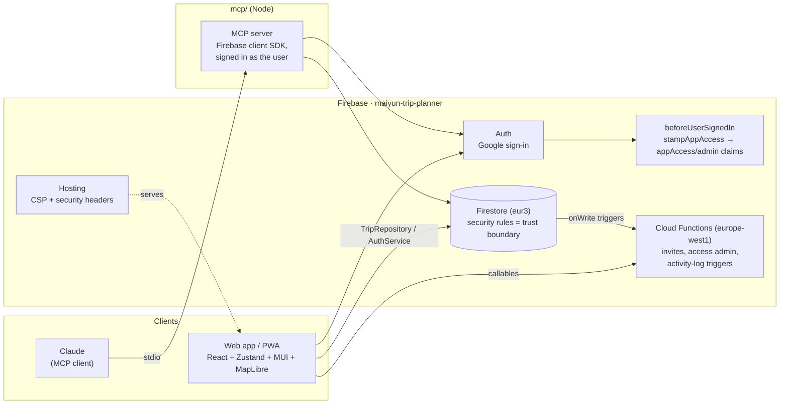

# trip-planner

[](https://github.com/Hawuawu/trip-planner/actions/workflows/test.yml)

**Maiyun's Trip Planner** is a shared, offline-friendly travel itinerary PWA. You plan a trip as a checkpoint timeline next to a map before you leave, then keep editing it on your phone during the trip. An AI assistant (Claude) can read and edit the same itinerary through an MCP server.

Live (approval-gated): https://trip.maiyun.eu/

## The problem

Planning a multi-week trip, in this case Japan with a travel companion, scatters the plan across many places:

- booking confirmation emails
- a saved-places list in a maps app
- a shared doc of "maybe" ideas
- a budget spreadsheet
- chat threads

Each tool knows one part, and none of them answers the questions that matter during the trip:

- _What's next, and where?_
- _We missed the train. What does the rest of today look like now?_
- _That temple we bookmarked is 10 minutes away. Can we fit it in?_

And all of this happens on a phone, one-handed, often with poor signal.

The goal was **one source of truth for a trip** that:

1. **Works for planning and for travelling.** It's the same app, with no separate "trip mode" that loses features.
2. **Is shared live between companions.** Both people edit the same trip, with no copies or re-sharing.
3. **Survives bad conditions.** It's installable, lets you edit offline, and is readable in sunlight.
4. **Lets an AI assistant help with the plan.** Claude can propose and make edits, but only as the signed-in user and under the same security rules as the app.
5. **Is safe to open to friends.** Access is approval-gated and every change is audited.

## What it does

| Trip phase          | Capabilities                                                                                                                                                                                                                                                                                                         |
| ------------------- | -------------------------------------------------------------------------------------------------------------------------------------------------------------------------------------------------------------------------------------------------------------------------------------------------------------------- |
| **Planning**        | Checkpoint timeline (flights, layovers, trains, metro, hotel stays as date-range "bases", POIs) with drag-to-reorder and insert-between. A shortlist of not-yet-scheduled "alternatives". Day filter and themed, day-scoped route variants. Markdown notes, Google Maps/Search links, bookings linked to checkpoints |
| **Reviewing**       | Timeline and map show the same checkpoints, linked both ways: selecting one highlights it in the other. 3D map with buildings, alternatives shown as pins, drop-a-pin to add a place. A trip wiki (sectioned markdown linked to checkpoints/routes). Multiple named budgets with categorized, priced items           |
| **Sharing**         | Invite companions by email. Every member has full edit rights and sees changes live. The owner sees a per-trip activity log (who changed what) with pagination and filtering                                                                                                                                         |
| **During the trip** | The timeline opens on the current/upcoming checkpoint. Live position marker with compass heading. Destination-timezone-correct times. Edits work offline and sync later. Kanji → romaji/furigana readings that work offline. Installable PWA that updates itself after a deploy                                      |
| **With Claude**     | An MCP server with ~40 tools to read the trip and add or update checkpoints, alternatives, bookings, routes, wiki sections and budgets, signed in as you                                                                                                                                                             |
| **Portability**     | YAML export/import of a whole trip                                                                                                                                                                                                                                                                                   |

It deliberately does **not** book anything, and it doesn't require a "finished" plan: a half-planned trip with gaps is a normal, expected state. See [WORKFLOW.md](WORKFLOW.md) for the full user journeys.

## Design principles

From [DESIGN.md](DESIGN.md), in priority order:

1. **Legible and fast in bad conditions.** Design for a phone in bright sun with spotty signal first. Desktop planning comes second.
2. **Never block on the network.** Writes are optimistic, and a write you just made never shows a spinner.
3. **Nothing is ever locked.** There's no read-only mode and no separate edit mode.

Checkpoint type is shown by icon shape, not color (accessible, and still readable with many types). The single accent color marks "what's next".

## Architecture



Key decisions and the reasons behind them:

- **Repository boundary around the backend.** Components and stores never import `firebase/*`. Everything goes through `TripRepository` and `AuthService`, with a Firestore implementation and a localStorage implementation. This allows a zero-config local mode (no Firebase env vars needed), fast unit tests, and a backend that could be swapped later. See [CLAUDE.md](CLAUDE.md#architecture-rule--always-follow-this).
- **Firestore security rules are the only trust boundary.** Every read and write requires the `appAccess` claim plus trip membership, and every write must carry a `lastModifiedBy` stamp matching the caller. The web app and the MCP server both connect as the end user through the Firebase client SDK. Nothing uses a shared admin key for user data, so the AI assistant can never do more than the user could in the UI.
- **Approval-based access as data, not code.** A blocking function adds `appAccess`/`admin` claims on each sign-in, based on the `allowedUsers` collection. Signing in _is_ the access request, admins approve in-app, and promoting someone to admin is a Firestore field rather than a deploy.
- **Auditing that can't be skipped by accident.** Activity logging is done by Firestore triggers reacting to `lastModifiedBy`, not by each mutation remembering to call a logger. Writes from the MCP server and from the UI are logged the same way.
- **Offline-first UX on a live-sync backend.** Optimistic Zustand updates with rollback, Firestore `onSnapshot` for live collaboration, and Workbox caching for the app shell and the offline kanji dictionary (offline map tiles are tracked in #52).
- **Keep it simple.** This is an app for two people, not a platform. YAGNI, the Rule of Three, and no speculative abstractions ([STANDARDS.md](STANDARDS.md#development-philosophy)).

**Stack:** Vite · React · TypeScript · Zustand · MUI (incl. `@mui/lab` Timeline) · MapLibre GL via `react-map-gl` with OpenFreeMap tiles · Firebase (Auth, Firestore, Cloud Functions, Hosting) · `vite-plugin-pwa` · `@modelcontextprotocol/sdk` · Vitest + Testing Library + Firebase emulators.

## How it was built

The second goal was to find out how far **AI-assisted development** can go on a real product without the codebase decaying. The approach was to keep the process strict and let the agent (Claude Code) move fast inside it:

- **Issue-first planning.** Each feature starts as a GitHub issue grounded in prior issues and the current code: context, design, test cases, open questions, out of scope. A repo skill ([`.claude/skills/feature-planning`](.claude/skills/feature-planning/SKILL.md)) makes this repeatable.
- **Written rules the agent must follow:** [CLAUDE.md](CLAUDE.md) for architecture rules and the data model, [STANDARDS.md](STANDARDS.md) for coding, testing, a11y, performance and security conventions, and [DESIGN.md](DESIGN.md) for UX.
- **Automated guardrails, not reminders:**
  - Husky pre-commit (lint-staged) and pre-push (build + SAST)
  - Claude hooks that block `eslint-disable` and direct commits to `main`, and run SAST on edits
  - ESLint security and jsx-a11y plugins
  - coverage thresholds (85% lines / 80% branches)
  - Firestore-rules tests against the emulators
  - DAST, CodeQL, and a coverage comment on every PR
- **Small branches through `develop`.** One branch per issue, with `develop` promoted to `main` and deployed by GitHub Actions to Firebase.

The result so far: about 200 commits, 80+ merged PRs and 75+ closed issues in roughly six weeks, with 950+ unit/integration tests.

## Status and roadmap

The app is being used to plan a real trip. Open work is tracked in [issues](https://github.com/Hawuawu/trip-planner/issues), notably:

- full offline mode (#52)
- Playwright end-to-end tests (#15)
- hosting the MCP server over HTTP with Google OAuth so Claude.ai connectors can use it without a local install (#144)
- CI hardening: deploys gated on tests, Node 22, one copy of each config (#138, #140, #141)

## Documentation

| File                           | Purpose                                                                 |
| ------------------------------ | ----------------------------------------------------------------------- |
| [WORKFLOW.md](WORKFLOW.md)     | End-to-end user workflows: planning, sharing, travel, post-trip         |
| [DESIGN.md](DESIGN.md)         | UX direction: layout, visual conventions, editing model, states         |
| [CLAUDE.md](CLAUDE.md)         | Implementation spec: stack, architecture rules, data model, conventions |
| [STANDARDS.md](STANDARDS.md)   | Coding, testing, git, accessibility, performance and security standards |
| [MCP.md](MCP.md)               | MCP server design: Claude ↔ trip data integration                       |
| [mcp/README.md](mcp/README.md) | MCP server setup: OAuth client, config, running it locally              |

---

# Developer guide

## Project structure

```
src/         the web app (Vite + React) — see "Local development" below
functions/   Cloud Functions (Node, own package.json) — the app-access gate's
             blocking function, trip invites, activity logging
mcp/         MCP server (Node, own package.json) — lets Claude read/edit
             trip data directly; see mcp/README.md and MCP.md
scripts/     tooling (e.g. the DAST scan run in CI)
```

`functions/` and `mcp/` are independent Node packages, each with their own
`package.json`/dependency tree/build step — neither is part of the root
`npm install` or the Vite build. Install and build each from inside its own
directory.

## Running with Docker

The fastest way to get a local dev server running without installing Node:

```bash
# copy and fill in your Firebase config
cp .env.example .env

# start the dev server (hot reload enabled)
docker compose up
```

App is available at **http://localhost:5173**.

To build and serve a production image:

```bash
docker compose --profile prod up
```

Production build served by nginx at **http://localhost:8080**.

## Local development

Requires Node 20+.

```bash
npm install
cp .env.example .env   # fill in Firebase config
npm run dev
```

Other commands:

```bash
npm run build    # production build
npm run lint     # lint
npm run preview  # preview production build locally
```

## Firebase setup

1. Create a Firebase project at [console.firebase.google.com](https://console.firebase.google.com).
2. Enable **Firestore** and **Authentication** (Google provider — sign-in is Google-only, see "Inviting people" below for the app-access model on top of it).
3. Copy your web app config values into `.env` (see `.env.example`).
4. Deploy Firestore security rules: `firebase deploy --only firestore:rules`.
5. Install and deploy Cloud Functions — required for sign-in to work at all, since the app-access gate is enforced by a blocking function:
   ```bash
   cd functions
   npm install
   npm run build
   cd ..
   firebase deploy --only functions
   ```
   See the bootstrap note under "Inviting people" below — `allowedUsers` starts empty, so seed your own admin doc before anyone can sign in and get approved.

Security rules enforce that only `trips/{tripId}.memberIds` members — and only accounts with the `appAccess` custom claim — can read or write a trip's subcollections. See `firestore.rules` and `functions/src/appAccess.ts`/`functions/src/authGate.ts`.

## Inviting people

### To the app (admin approves)

App access is approval-based. Anyone can sign in with Google, but an Auth blocking function stamps every sign-in with `appAccess`/`admin` custom claims read from the person's `allowedUsers` doc — `appAccess: true` only for emails in that collection, `admin: true` only if their doc's `role` field is `'admin'`. Admin isn't a hardcoded identity anywhere in the code; it's just data, so promoting or demoting someone is a Firestore field, not a deploy. Both the UI and the Firestore security rules require the `appAccess` claim, so an unapproved account can't see or touch any data. Signing in _is_ the access request:

1. Tell the person to open the app and sign in with Google once. They'll land on a "waiting for approval" screen, and their request appears for an admin automatically.
2. An admin opens **App access → Requests** from the trip-selector toolbar and clicks approve (or deny).
3. The person hits **Check again** on their waiting screen (or just comes back later) — their access claim refreshes and the app opens up. No second sign-in needed.

The **People** tab lists everyone with access. Each row has a make-admin/remove-admin toggle and a revoke button — any admin can promote or demote any other; the server refuses to demote or revoke the last remaining admin, so the app can never end up unmanageable. Revoking someone: future sign-ins lose the claim, their current session lapses within about an hour, and their trips and memberships are kept in case they're re-approved (revoked people reappear in the Requests tab, and re-approval always starts them back at plain member — admin has to be re-granted deliberately). The **Activity** tab is an audit trail: access requested/approved/denied/revoked, admin made/removed.

> **One-time bootstrap:** `allowedUsers` starts empty. Before the first deploy of `functions/`, seed at least one admin directly in the Firebase Console's Firestore tab: create `allowedUsers/{email}` with `{ invitedVia: 'seed', role: 'admin', createdAt: <a timestamp> }` for your own account (and plain `role: 'member'` docs for any existing collaborators) — otherwise nobody lands with permission to approve anyone, including themselves. Everyone must also sign in once _after_ the deploy for their access claims to be stamped.

### To a trip (any trip owner)

Trip sharing is separate from app access: the trip's owner opens the trip's members dialog and invites a companion by email, which gives them full edit access to that trip. The person must already be approved for the app (see above) and have signed in once. See [WORKFLOW.md](WORKFLOW.md#4-sharing-with-a-travel-companion) for the full workflow.

## Data model

```
trips/{tripId}                       — name, dateRange, memberIds, ownerId?, memberProfiles?
trips/{tripId}/checkpoints/{id}      — type, name, startTime, endTime?, location?, notes?, linkedBookingId?
trips/{tripId}/alternatives/{id}     — same shape as a POI checkpoint, not on the timeline
trips/{tripId}/bookings/{id}         — provider, confirmationNumber, notes
trips/{tripId}/routes/{id}           — themed, day-scoped plan variants
trips/{tripId}/wikiSections/{id}     — trip summary wiki (markdown, linkable)
trips/{tripId}/budgets/{id}          — named budgets → budgetSections → budgetItems
trips/{tripId}/activityLog/{id}      — owner-readable audit trail for that trip

allowedUsers/{email}                 — app-access allowlist (role: member | admin)
accessRequests/{email}               — pending/approved/denied/revoked sign-in requests
appActivityLog/{id}                  — admin-readable audit trail for app access itself
```

Checkpoint types: `flight | train | metro | hotel | poi | other`

## MCP server

Claude can read and edit trip data (checkpoints, alternatives, bookings, routes, wiki, budgets) directly, signed in as you rather than through a shared credential. Lives at [`mcp/`](mcp/) — see [`mcp/README.md`](mcp/README.md) for setup and [MCP.md](MCP.md) for the full design (auth model, tool list, what's deliberately out of scope).

## License

See [LICENSE](LICENSE).
